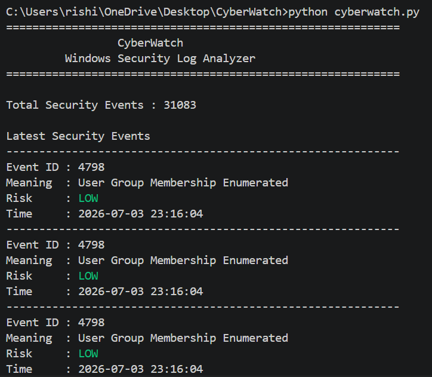
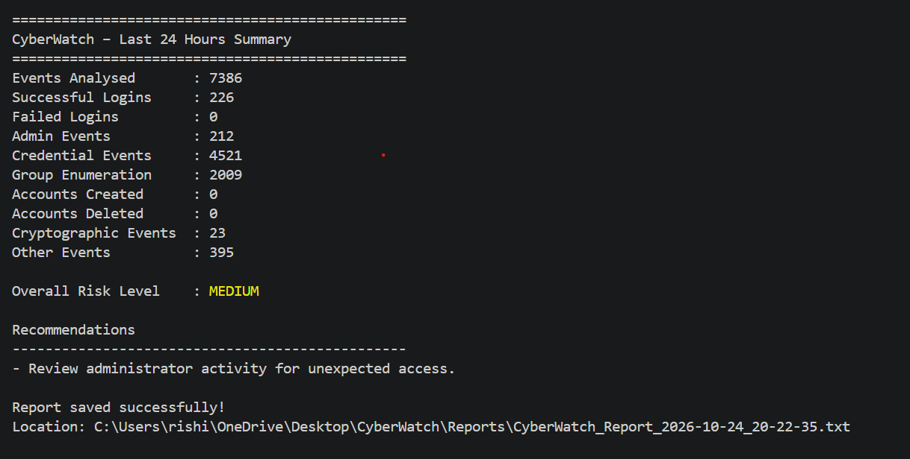

# 🛡️ CyberWatch – Windows Security Log Analyzer

## 📌 Project Overview

CyberWatch is a Python-based Windows Security Log Analyzer developed as a hands-on cybersecurity portfolio project.

Windows operating systems generate thousands of security events related to user logins, administrative privileges, credential access, and account management. Manually reviewing these logs can be time-consuming and challenging.

CyberWatch simplifies this process by reading Windows Security Event Logs, identifying important security events, classifying their risk levels, generating security summaries, and automatically creating security reports.

This project demonstrates foundational Security Operations Center (SOC) concepts, including log analysis, event monitoring, rule-based risk assessment, and security reporting.

---

## ✨ Key Features

- 🔍 **Windows Security Log Analysis:** Reads security events directly from Windows Event Logs.
- ⏰ **24-Hour Monitoring:** Analyzes security events generated within the last 24 hours.
- 🛡️ **Security Event Detection:** Identifies important Windows Security Event IDs.
- 🚦 **Risk Classification:** Categorizes selected events into LOW, MEDIUM, and HIGH risk levels using predefined rules.
- 🎨 **Colour-Coded Output:** Displays event risk levels using different colours.
- 📊 **Security Summary:** Counts important security activities during the analysis period.
- ⚠️ **Overall Risk Assessment:** Calculates an overall risk level using event thresholds.
- 💡 **Security Recommendations:** Suggests actions based on detected activities.
- 📝 **Automated Reports:** Generates timestamped security reports.

---

## 🔐 Windows Security Events Monitored

| Event ID | Description | Risk Level |
|---|---|---|
| 4624 | Successful Login | LOW |
| 4625 | Failed Login Attempt | HIGH |
| 4672 | Special Privileges Assigned to New Logon | MEDIUM |
| 4720 | User Account Created | HIGH |
| 4726 | User Account Deleted | MEDIUM |
| 5379 | Credential Manager Credentials Read | LOW |
| 5061 | Cryptographic Operation | LOW |
| 4798 | User Group Membership Enumerated | LOW |

Events outside these predefined categories are classified as informational events.

**Note:** Risk levels are educational, rule-based indicators and do not confirm malicious activity.

---

## 🛠️ Technologies Used

- **Python 3.12** – Core programming language
- **pywin32** – Accessing Windows Security Event Logs
- **colorama** – Colour-coded terminal output
- **Windows Event Viewer** – Understanding Windows security events
- **Git** – Version control
- **GitHub** – Source code hosting and documentation
- **Visual Studio Code** – Development environment

---

## 📂 Project Structure

```text
CyberWatch/
│
├── cyberwatch.py
├── README.md
├── requirements.txt
├── CyberWatch_Report.txt
│
├── Reports/
│   └── CyberWatch_Report_YYYY-MM-DD_HH-MM-SS.txt
│
└── screenshots/
    ├── overview.png
    └── summary.png
```

The `Reports/` folder is created automatically when the application runs. It contains timestamped security reports.

The original `CyberWatch_Report.txt` is retained from Version 1.

Generated reports are local output files and are not required to run the application.

---

## 🚀 Installation and Usage

### Step 1: Install Python

Install Python 3.12 or a compatible Python version.

### Step 2: Clone the Repository

```bash
git clone https://github.com/rishithapipavath6-art/CyberWatch.git
cd CyberWatch
```

### Step 3: Install Dependencies

```bash
python -m pip install -r requirements.txt
```

Required Python libraries:

- pywin32
- colorama

### Step 4: Run as Administrator

Open Command Prompt or Visual Studio Code with Administrator privileges.

CyberWatch requires permission to access the Windows Security Event Log.

### Step 5: Run CyberWatch

```bash
python cyberwatch.py
```

The application analyzes security events from the last 24 hours and displays the results in the terminal.

**Platform:** Windows

---

## 📊 Security Analysis and Risk Assessment

CyberWatch analyzes the Windows Security Event Log and summarizes:

- Successful login events
- Failed login events
- Administrator privilege events
- Credential-related events
- Group membership enumeration
- User account creation
- User account deletion
- Cryptographic operations
- Other security events

### Overall Risk Classification

CyberWatch uses the following predefined rules:

| Risk Level | Condition |
|---|---|
| HIGH | Five or more failed login events, or at least one account creation event |
| MEDIUM | Three or more administrator privilege events, or at least one account deletion event, when HIGH conditions are not met |
| LOW | Neither HIGH nor MEDIUM conditions are met |

These thresholds are designed for learning and demonstration. They are not production-grade threat detection rules.

---

## 📸 Screenshots

### CyberWatch Overview



### Security Summary



These screenshots demonstrate CyberWatch's terminal-based event analysis and security summary.

---

## 📝 Automated Security Reports

CyberWatch automatically generates a timestamped text report containing:

- Report generation date and time
- Analysis period
- Number of events analyzed
- Security event statistics
- Overall risk level
- Security recommendations

Example report filename:

```text
CyberWatch_Report_2026-10-24_20-10-05.txt
```

Reports are saved inside the `Reports/` folder.

---

## 🚀 Version 2 – 24-Hour Security Monitoring

CyberWatch Version 2 extends the original Windows Security Log Analyzer with time-based event analysis and additional monitoring capabilities.

### What's New in Version 2?

- Analyzes available Windows Security Events generated during the last 24 hours.
- Reads multiple batches of events instead of limiting analysis to the latest 1,000 records.
- Displays up to 30 recent events while calculating statistics for the full analysis period.
- Tracks additional security event categories.
- Provides rule-based overall risk classification.
- Generates security recommendations.
- Automatically saves timestamped reports in a dedicated folder.

### Example Analysis Results

During a sample execution, CyberWatch analyzed **7,371 security events** from the preceding 24 hours.

| Security Activity | Events |
|---|---:|
| Successful Logins | 225 |
| Failed Logins | 0 |
| Administrator Privilege Events | 211 |
| Credential Events | 4,515 |
| Group Enumeration | 2,005 |
| Accounts Created | 0 |
| Accounts Deleted | 0 |
| Cryptographic Events | 22 |
| Other Events | 393 |
| **Total Events Analyzed** | **7,371** |

### Overall Risk Level: MEDIUM

The MEDIUM classification was triggered by the predefined administrator privilege event threshold.

**Recommendation:** Review administrator activity for unexpected access.

These results are from a sample execution and do not establish that malicious activity occurred.

---

## 📈 Future Improvements

Planned enhancements include:

- Real-time security event monitoring
- Suspicious login pattern detection
- Custom date-range filtering
- Advanced contextual risk scoring
- Interactive security dashboard
- Email notifications for high-risk events
- PDF report generation
- Improved event filtering and investigation capabilities

---

## 🎯 Learning Outcomes

Developing CyberWatch provided practical experience with:

- Python programming and automation
- Windows Security Event Logs
- Windows Event ID interpretation
- Security event classification
- Basic SOC monitoring concepts
- Rule-based security analysis
- Automated security reporting
- Git and GitHub version control

This project strengthened my understanding of how security logs support the identification and investigation of potentially suspicious system activities.

---

## 👩‍💻 Author

**Rishitha**

Cybersecurity Student | Python Programming | Security Monitoring | SOC Fundamentals

Building practical cybersecurity projects alongside my studies to strengthen my technical skills and gain hands-on experience in security analysis and automation.

---

## 📌 Disclaimer

CyberWatch is an educational cybersecurity project intended for learning, experimentation, and portfolio demonstration.

Its predefined risk rules are simplified and should not be used as the sole basis for identifying security incidents or making production security decisions.
